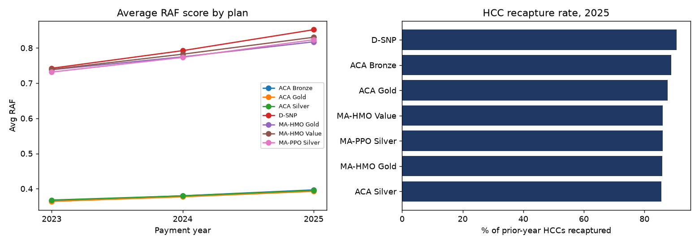

# Medicare Advantage & ACA Risk Adjustment Analytics

**Business question:** How accurate and complete are our members' risk scores, and which plans are losing
Risk Adjustment accuracy because chronic conditions are not re-documented each year?

This project analyzes Risk Adjustment Factor (RAF) trends and program performance for **Medicare Advantage**
and **ACA** populations, from data preparation and validation through SQL reporting, statistical testing,
data visualization, and a stakeholder PowerPoint deck.

> **Data note:** all data is **synthetic** and generated by `src/generate_data.py`. It follows the structure
> of CMS-HCC risk adjustment data (member-year rows, HCC flags, demographic and disease scores), but HCC
> coefficients are illustrative, not official CMS rates. No real member data is used.

**Tools:** SQL (SQLite: CTEs, window functions, UNION ALL unpivot) · Python (Pandas, SciPy, Statsmodels,
Matplotlib, Plotly) · R (dplyr, ggplot2) · SAS (PROC SQL, PROC TTEST, PROC GLM) · Tableau-ready extracts ·
PowerPoint (python-pptx)



## Key findings (synthetic data, payment years 2023-2025)

| Finding | Result |
|---|---|
| MA average RAF, 2024 to 2025 | 0.781 to 0.831 (Welch t = 12.9, p < 0.001) |
| ACA average RAF, 2024 to 2025 | 0.379 to 0.395 (Welch t = 6.4, p < 0.001) |
| Highest RAF growth | D-SNP, +7.5% year over year |
| HCC recapture rate, 2025 | 85.7% (ACA Silver) to 90.6% (D-SNP) |
| Strongest RAF drivers (OLS, R² = 0.92) | HCC count, dual eligibility, age |

**Recommendation:** prioritize chart reviews and annual wellness visits for the lowest-recapture plans
(ACA Silver, MA-HMO Gold), where un-recaptured chronic HCCs understate risk scores.

## Pipeline

```
generate_data.py  ->  data/member_years.csv, data/hcc_reference.csv
run_analysis.py   ->  1. load into SQLite
                      2. sql/01_data_quality_checks.sql  (quarantine failing records)
                      3. sql/02-05 reporting queries      -> outputs/tableau/*.csv
                      4. Welch t-tests + OLS regression   -> outputs/statistical_tests.txt
                      5. charts + interactive dashboard   -> outputs/charts, outputs/risk_adjustment_dashboard.html
                      6. stakeholder deck                 -> outputs/Risk_Adjustment_Insights.pptx
r/risk_adjustment_analysis.R      same statistics in R
sas/risk_adjustment_analysis.sas  same statistics in SAS
```

| SQL script | What it answers |
|---|---|
| `01_data_quality_checks.sql` | Missing county, invalid RAF, duplicates, age vs segment, HCC count mismatch |
| `02_raf_trend_by_plan.sql` | Average RAF by plan and year with YoY change (`LAG` window function) |
| `03_hcc_recapture_rate.sql` | Share of prior-year HCCs documented again this year |
| `04_hcc_prevalence.sql` | Most common conditions by segment and year |
| `05_raf_by_county.sql` | Average RAF and dual-eligible share by county |

Metric definitions and business rules: [docs/data_dictionary_and_metrics.md](docs/data_dictionary_and_metrics.md)

## Run it

```bash
pip install -r requirements.txt
python src/generate_data.py
python src/run_analysis.py
```

Open `outputs/risk_adjustment_dashboard.html` in a browser for the interactive dashboard.

**Tableau:** connect Tableau Public or Desktop to the CSVs in `outputs/tableau/` (text file connection) to
rebuild the RAF trend, recapture, and county views.

**R:** `Rscript r/risk_adjustment_analysis.R` (needs `dplyr`, `ggplot2`).
**SAS:** upload `data/member_years.csv` to SAS OnDemand for Academics, set `%let path`, and run
`sas/risk_adjustment_analysis.sas`.
