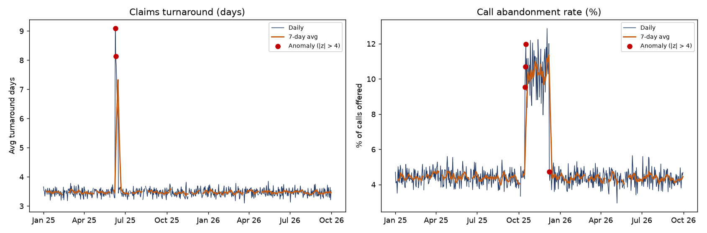

# Operational Performance Reporting & Data Quality Automation

**Business question:** Can operations leaders trust the daily claims and call-center numbers, and what changed
in performance this week?

This project automates a daily operational reporting cycle for a health plan: data quality checks on two
source systems, cross-source reconciliation against the reporting system, KPI reporting with trends, anomaly
detection, and outputs for Tableau, Excel, and an interactive dashboard. It replaces a manual Excel review.

> **Data note:** all data is **synthetic** and generated by `src/generate_data.py`. It follows the structure of
> claims-processing and call-center extracts. Data defects (duplicates, nulls, negative values, logical errors,
> a missing day, reconciliation breaks) and two operational events (a claims system outage and a Medicare
> open-enrollment call surge) are injected on purpose so the pipeline has real work to do.

**Tools:** SQL (SQLite: recursive CTE calendar, window functions, rolling averages, LAG) · Python (Pandas,
Matplotlib, Plotly, openpyxl) · Tableau-ready extracts · Excel (conditional formatting)



## Key findings (synthetic data, Jan 2025 - Sep 2026)

| Finding | Result |
|---|---|
| Data quality | 11 checks; 7 failed, 20 rows quarantined (6 duplicates removed first), 1 missing day |
| Reconciliation | 13 of 638 days outside the 0.5% tolerance, each labeled with a likely cause |
| Claims outage, 9 Jun 2025 | Processing rate fell to 25%, turnaround rose from 3.5 to 9.1 days; backlog cleared in 7 days |
| Open enrollment, 15 Oct - 7 Dec 2025 | Abandonment 10.4% vs 4.4% baseline; speed of answer 96 s vs 37 s |
| Steady-state KPIs | Auto-adjudication 88.2%, denial rate 5.6%, answer rate 95.6%, turnaround 3.5 days |
| Automation | 11 checks + 638-day reconciliation + 5 KPI anomaly scans over 4,469 rows in under 1 second |

Anomaly detection (|z| > 4 against a 28-day baseline) found both events on their first day and raised two
single-day false positives, which are listed in `outputs/anomaly_events.csv` for review.

**Recommendation:** add temporary call-center staffing for Member and Broker queues before the open-enrollment
window, and add a same-day backlog alert (processing rate below 90%) so an outage is escalated on day one.

## Pipeline

```
generate_data.py  ->  data/claims_ops.csv, data/call_center.csv, data/daily_ops_summary.csv
run_report.py     ->  1. load into SQLite
                      2. sql/01_data_quality_checks.sql      -> outputs/data_quality_report.csv/.html
                      3. quarantine failing rows             -> outputs/quarantined_records.csv
                      4. sql/02_cross_source_reconciliation  -> outputs/reconciliation_exceptions.csv
                      5. sql/03 daily KPIs, sql/04 weekly    -> outputs/tableau/*.csv
                      6. rolling z-score anomaly detection   -> outputs/anomalies.csv, anomaly_events.csv
                      7. charts, dashboard, Excel            -> outputs/charts, operations_dashboard.html,
                                                                Operations_KPI_Report.xlsx
```

| SQL script | What it answers |
|---|---|
| `01_data_quality_checks.sql` | Completeness, uniqueness, validity, consistency, missing dates (recursive calendar) |
| `02_cross_source_reconciliation.sql` | Does the reporting system match the claims source within 0.5%? |
| `03_daily_kpis.sql` | Processing, auto-adjudication, denial, clean-claim, turnaround, answer, abandonment, AHT, ASA |
| `04_weekly_kpi_trends.sql` | Weekly KPIs with 7-day rolling averages and week-over-week change |

Metric definitions, data quality rules and the reporting process:
[docs/metric_definitions_and_reporting_process.md](docs/metric_definitions_and_reporting_process.md)

## Run it

```bash
pip install -r requirements.txt
python src/generate_data.py
python src/run_report.py
```

Open `outputs/operations_dashboard.html` for the interactive dashboard and `outputs/data_quality_report.html`
for the pass/fail data quality report.

**Tableau:** connect Tableau Public or Desktop to `outputs/tableau/daily_kpis.csv` and `weekly_kpis.csv`
(text file connection); build steps are in the docs file above.
