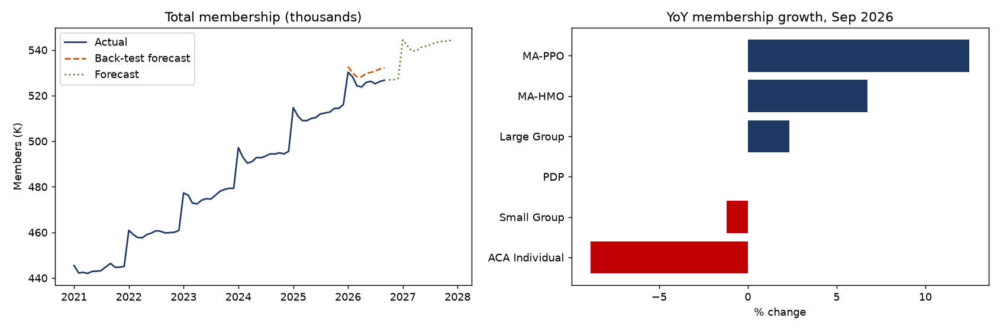

# Membership Reporting & Forecasting Dashboard

**Business question:** Where is membership growing or shrinking by product and region, does it reconcile to
Finance, and how far is it tracking from budget and forecast?

A monthly membership reporting cycle for a health plan: data collection and validation, SQL reporting,
Finance reconciliation, Holt-Winters forecasting, variance research, and delivery in **Power BI**, a
**Microsoft Excel** workbook, and a **Google Sheets** report.

> **Data note:** all data is **synthetic** and generated by `src/generate_data.py`, in the layout of a
> membership reporting mart (month x product x region). 2026 includes two market shifts that history cannot
> predict, an ACA subsidy expiry and a competitor leaving the PPO market, so the variance analysis has real
> causes to find. No real enrollment data is used.

**Tools:** SQL (SQLite: CTEs, window functions, `LAG`, `LEFT JOIN` reconciliation) · Python (Pandas,
Statsmodels Holt-Winters, Matplotlib, Plotly) · Power BI (star schema + DAX) · Excel (PivotTable, SUMIFS,
XLOOKUP, INDEX-MATCH, VLOOKUP, data validation, conditional formatting) · Google Sheets (Apps Script, QUERY,
pivot table, XLOOKUP)



## Key findings (synthetic data, September 2026)

| Finding | Result |
|---|---|
| Total membership | 526,768 across 6 products and 5 counties |
| Fastest growth | MA-PPO +12.5% YoY (competitor exit), MA-HMO +6.8% |
| Largest decline | ACA Individual -8.9% YoY, 18.6% below budget (subsidy expiry) |
| Forecast accuracy (back-test, Jan-Sep 2026 MAPE) | 0.3% for stable products; 3.0% MA-PPO and 12.8% ACA, flagged for research |
| Finance reconciliation exceptions | 6 of 2,070 product-region-months above 1% tolerance: a late Finance file (MA-PPO Philadelphia, Mar 2026, 7.0%) and retro terminations (ACA Individual, Jun 2026, 3.0%) |

## Pipeline

```
generate_data.py  ->  data/ (enrollment, finance billed membership, 2026 budget, product dimension)
run_reporting.py  ->  1. load into SQLite
                      2. sql/04_data_validation.sql         -> outputs/data_validation_report.csv
                      3. sql/01_membership_summary.sql      (members, adds, terms, MoM, YoY)
                      4. sql/02_finance_reconciliation.sql  -> outputs/reconciliation_exceptions.csv
                      5. sql/03_budget_variance.sql
                      6. Holt-Winters forecast + back-test  -> outputs/forecast_accuracy.csv
                      7. Power BI star schema               -> outputs/powerbi/*.csv
                      8. Excel workbook                     -> outputs/Membership_Report.xlsx
                      9. Google Sheets extracts             -> outputs/google_sheets/*.csv
                     10. charts + interactive dashboard     -> outputs/membership_dashboard.html
```

Data definitions, business rules and the monthly reporting procedure:
[docs/data_definitions_and_business_rules.md](docs/data_definitions_and_business_rules.md)

## Deliverables

**Excel** — `outputs/Membership_Report.xlsx`
- *Report*: pick a product and month from dropdowns (data validation); members, YoY, adds, terms and budget
  variance calculated with SUMIFS and EDATE; owner team with XLOOKUP, VLOOKUP and INDEX-MATCH.
- *Pivot*: PivotTable of average monthly members by product and year, filtered by line of business.
- *Budget*: actual vs budget with variance formulas and red/green conditional formatting at 2%.
- *Forecast*, *Reconciliation*, *Data*: Excel tables with filters.
- XLOOKUP needs Excel 2021 or Microsoft 365.

**Google Sheets** — [`google_sheets/build_membership_report.gs`](google_sheets/build_membership_report.gs)
1. Create a blank sheet at [sheets.new](https://sheets.new).
2. Extensions > Apps Script, paste the file, save, run `buildMembershipReport` and approve access.
3. The script pulls the CSVs from this branch and builds Report (dropdowns, SUMIFS, XLOOKUP, INDEX-MATCH),
   Query (`QUERY` summaries), Pivot (pivot table) and Budget (conditional formatting) tabs, plus a
   *Membership Report > Refresh* menu.

**Power BI** — star schema in `outputs/powerbi/`, measures in [powerbi/measures.dax](powerbi/measures.dax),
build steps in [powerbi/README.md](powerbi/README.md).

**Interactive dashboard** — open `outputs/membership_dashboard.html` in a browser.

## Run it

```bash
pip install -r requirements.txt
python src/generate_data.py
python src/run_reporting.py
```

The Excel PivotTable is added through Excel on Windows (pywin32); on other systems the rest of the workbook
still builds.
