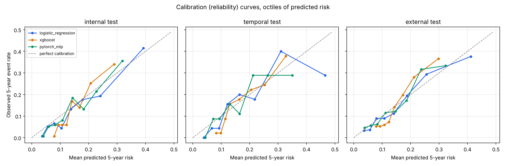

# Cardiovascular Risk Prediction on EHR Data: Evaluation Beyond AUROC + Clinical-Note Extraction Harness

**Question:** Can a 5-year cardiovascular disease (CVD) risk model built on longitudinal EHR data be trusted
in a different time period, at a different site, and for every patient subgroup? And can structured facts be
pulled reliably from clinical notes, with an evaluation harness that tells you when they can't?

Two parts, one synthetic EHR source:

1. **Risk model.** Synthea EHR records → **OMOP CDM** tables (DuckDB SQL) → landmark cohort → logistic
   regression, XGBoost and a **PyTorch** MLP → evaluation of **calibration, subgroup performance, temporal
   validation, external validation, dataset-shift stress tests, recalibration and decision curves**.
2. **Clinical-note extraction.** A **schema-constrained LLM extractor** (Pydantic schema, validation and
   repair retries, evidence quotes) for local models (Ollama, vLLM) or cloud APIs, plus an **evaluation
   harness** that scores any extractor against reference labels from the structured EHR.

> **Data note:** all data is **synthetic**, generated by [Synthea](https://github.com/synthetichealth/synthea)
> (`scripts/generate_synthea.sh`). No real patient data is used. Synthea's disease models are simplified,
> so the numbers below show the *methods*, not clinical truth.

**Tools:** Python (pandas, scikit-learn, XGBoost, PyTorch, Pydantic, Matplotlib) · SQL (DuckDB: OMOP ETL,
cohort definitions, `PIVOT`, window functions, `regr_slope`) · OMOP CDM v5.4 · Synthea · pytest ·
GitHub Actions



## Key findings (synthetic data)

**Cohort:** 4,721 person-landmarks (1,678 people) at the development site (Massachusetts) and 2,424
(854 people) at the external site (Chicago, IL). The 5-year CVD event rate is 15%.

| Model | Internal AUROC (95% CI) | Temporal (2018) AUROC | External AUROC | Calibration slope, internal | Observed / expected, internal |
|---|---|---|---|---|---|
| Logistic regression | **0.764** (0.716–0.808) | **0.755** (0.694–0.808) | **0.747** (0.721–0.775) | 1.16 | 0.88 |
| XGBoost | 0.746 (0.694–0.789) | 0.731 (0.660–0.792) | 0.736 (0.708–0.761) | 1.74 | 0.90 |
| PyTorch MLP | 0.748 (0.702–0.790) | 0.713 (0.649–0.778) | 0.722 (0.692–0.751) | 1.32 | 0.93 |

CIs come from a 500-sample bootstrap resampled by person (people contribute several landmarks).

1. **The simplest model held up best.** Logistic regression had the highest AUROC on every test set and the
   best calibration. The PyTorch MLP had the lowest validation loss (0.362 vs 0.369), so the pipeline's
   rule picked it as "primary", but that did not carry over to test data. With 64 validation events, model
   selection by a single validation metric is noisy, and the confidence intervals overlap throughout.
2. **AUROC hides calibration problems.** XGBoost's calibration slope of 1.74 means its predictions are
   squeezed toward the average: low-risk patients are over-predicted and high-risk patients
   under-predicted (see the calibration curves above). Its AUROC alone would not show this.
3. **Subgroups:** discrimination was similar by sex, but calibration was not. The MLP **over-predicted risk
   for women** (observed/expected 0.69) and **under-predicted for men** (1.23). Within the 65–79 age band
   AUROC fell to 0.58: once age is fixed, the remaining features separate risk poorly. Race groups with
   fewer than 10 events are flagged as not assessable rather than reported as good or bad.
   ([table](outputs/subgroup_performance.csv), [figure](outputs/figures/subgroup_performance.png))
4. **Temporal validation:** the event rate rose from 14.3% (2006–2014) to 17.5% (2018), and AUROC dropped by
   0.01–0.04 depending on the model.
5. **Synthea's "external site" is not really shifted.** A classifier could not tell Illinois from
   Massachusetts patients (domain-classifier AUROC 0.50, no feature with |SMD| > 0.1), because Synthea runs
   the same disease modules in every state. So the project adds **controlled stress tests**:

| Scenario (external cohort) | Detectable from inputs? (domain AUROC) | AUROC | Observed / expected as deployed | After logistic recalibration |
|---|---|---|---|---|
| None | 0.50 | 0.707 | 1.07 | 1.07 |
| Case-mix shift (older, more diabetes) | 0.65 | 0.690 | 1.10 | 1.05 |
| Measurement shift (SBP +10 mmHg, 60% lipids missing) | **0.86** | 0.697 | 1.16 | 1.05 |
| Outcome under-coding (30% of events never recorded) | no input change | 0.680 | **0.79** | 1.20 |

   * The **measurement shift was the easiest to detect but did little harm.** The **outcome under-coding
     did the most harm and cannot be seen in the inputs at all.** Monitoring input drift is not enough;
     you also need outcome audits.
   * Recalibration fixed the over/under-prediction for the input shifts. For under-coding it overshot
     (0.79 → 1.20) because it was fitted on 427 people with 117 events. A small local
     calibration sample is itself a source of error.
     ([table](outputs/shift_stress_tests.csv), [figure](outputs/figures/shift_stress_tests.png))
6. **Decision curve:** all three models give more net benefit than treat-all or treat-none between about
   5% and 35% risk thresholds. ([figure](outputs/figures/decision_curve.png))

### Clinical-note extraction harness

Evaluated on **577 notes from 154 patients**. Per patient: the latest note, up to two notes from visits
where a cardiometabolic condition was diagnosed, and one random note.

| Metric | Rule-based baseline |
|---|---|
| Age / sex / smoking status accuracy | 0.993 / 0.993 / 0.967 |
| Conditions (11 labels): micro precision / recall / F1 | 0.957 / 1.000 / **0.978** |
| Medication classes (5 labels): micro precision / recall / F1 | 0.938 / 0.989 / **0.963** |
| Evidence quotes found verbatim in the note | 100% |
| **Active problem-list conditions a single note never mentions** | **73%** |

* **Read the baseline honestly:** Synthea notes are generated from a template, so a regex baseline is
  close to the ceiling. Real clinical notes (abbreviations, negation, copy-forward) are much harder. The
  harness and the LLM extraction path are the reusable parts.
* **Documentation gap:** a single visit note mentions only 27% of the conditions on the patient's active
  structured problem list. Note-level extraction has to be aggregated across a patient's notes to
  reconstruct a phenotype.
* **The "errors" were mostly timing:** most statin false positives are notes documenting simvastatin
  where the structured prescription starts 7 days *after* the note date. Reference labels taken from
  structured data have their own noise. That is why the harness writes error examples
  (`outputs/extraction/rules/error_examples.csv`) for review rather than only a score.
* **LLM backends** (`src/notes/extractors.py`): a local model via **Ollama** with JSON-schema-constrained
  decoding, or any **OpenAI-compatible endpoint** (OpenAI, vLLM or LM Studio on a local GPU). Invalid JSON
  or schema violations are sent back to the model with the validation error for up to two repairs, and
  every extracted fact must cite a verbatim quote. The LLM code path is unit-tested with a mock client.
  **LLM benchmark numbers are not reported here**, because no model was available in the build
  environment. Run them with:

```bash
python -m src.run_extraction_eval --backend ollama --model llama3.1:8b                    # local GPU
python -m src.run_extraction_eval --backend openai --model gpt-4o-mini                    # cloud
python -m src.run_extraction_eval --backend openai --model <model> --base-url http://localhost:8000/v1  # vLLM
```

## Pipeline

```
scripts/generate_synthea.sh   -> data/synthea/{dev_ma, ext_il, notes}   (Synthea CSV + clinical notes)
src/omop_etl.py               -> OMOP CDM v5.4-shaped DuckDB: person, death, visit_occurrence,
                                 observation_period, condition_occurrence, measurement, observation,
                                 drug_exposure, procedure_occurrence           (sql/omop/*.sql)
src/build_cohort.py           -> landmark cohort, 5-year CVD outcome, baseline + trajectory features
                                                                                (sql/cohort/*.sql)
src/run_risk_pipeline.py      -> models, bootstrap CIs, calibration, subgroups, temporal + external
                                 validation, shift stress tests, recalibration, decision curve
                                                                                -> outputs/, outputs/figures/
src/run_extraction_eval.py    -> note extraction harness                       -> outputs/extraction/
```

## Reproduce

```bash
pip install -r requirements.txt            # plus PyTorch for your hardware (see requirements.txt)
make data      # Synthea, Java 17+, about 30 minutes on 2 cores
make all       # OMOP ETL, cohort, models, extraction harness (about 2 minutes)
make test      # 13 tests: evaluation metrics, OMOP/cohort SQL, extraction + LLM repair logic
```

## Documentation

* [Cohort and outcome definition](docs/cohort_definition.md): eligibility, outcome codes, features, splits
* [OMOP mapping](docs/omop_mapping.md): what maps where, and what is simplified (vocabulary concept IDs)
* [Model card](docs/model_card.md): intended use, performance, subgroup results, limitations

## Limitations and next steps

* **Competing risks:** people who die of non-CVD causes within 5 years are excluded. A cause-specific or
  Fine-Gray survival model would handle them properly.
* **Vocabulary:** OMOP standard concept IDs need the Athena vocabulary, so cohort SQL uses source codes.
* **Synthetic data:** Synthea's risk factors map to outcomes more simply than real biology does, and its
  notes are templated. The next step is the same pipeline on MIMIC-IV (with credentialed access) or an
  institutional OMOP instance, plus LLM benchmarks on real clinical text.
* **Small validation set** for model selection, as shown in finding 1. Nested cross-validation would help.

*Built with an AI coding agent (Claude Code), reviewed and run end to end. Every number above is produced
by the code in this repository.*

**Author:** Omkar Dolas · [LinkedIn](https://linkedin.com/in/omkar-dolas)
